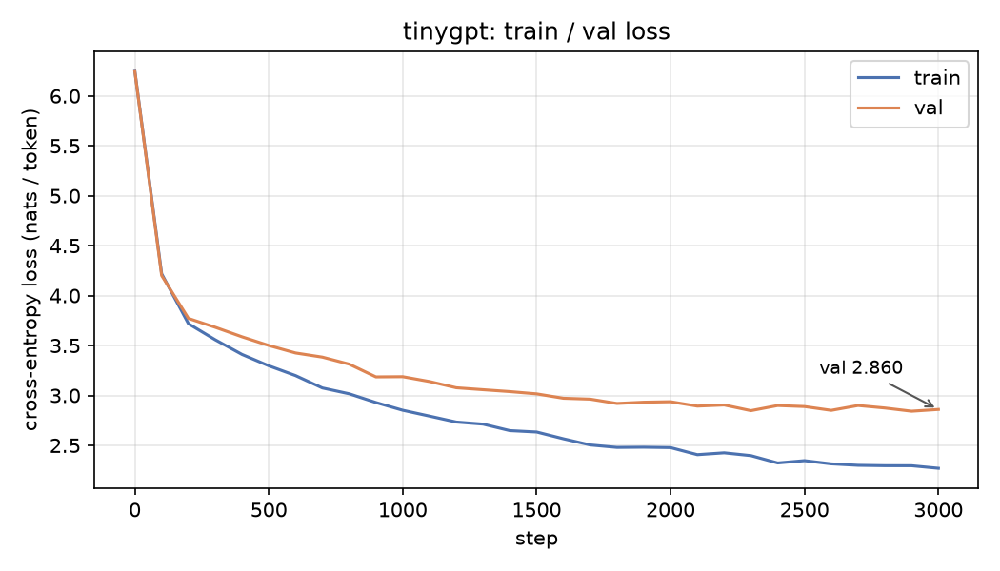

# tinygpt

**A GPT trained from scratch on a laptop CPU, readable end to end: byte-level BPE tokenizer, explicit causal attention, KV-cache generation, and a training loop with the loss curve and samples committed as evidence.**

[](https://github.com/rohanreddy79/tinygpt/actions/workflows/ci.yml)
[](LICENSE)

## Why

Most "GPT from scratch" code either hides the interesting parts behind a library call or stops
at the model and never trains. This repo is the whole pipeline in ~1,000 lines of plain PyTorch:
a BPE tokenizer trained with incremental pair counting, a decoder-only transformer whose
attention is written out (with an optional fused `scaled_dot_product_attention` path that is
tested against it), a KV cache whose outputs are tested to be identical to recomputation, and a
training loop that actually ran here, on an 8 GB Apple M3 with no GPU, in under three minutes.
Every number below comes from that run.

## Features

- `tinygpt.tokenizer`: byte-level BPE with a GPT-2-style regex pre-tokenizer. Exact round-trip
  on arbitrary Unicode (emoji, CJK, control characters); trains a 512-token vocab on 1.1 MB in
  0.4 s thanks to incremental pair counts over unique chunks; JSON save/load.
- `tinygpt.model`: `GPTConfig` dataclass, explicit `CausalSelfAttention` (q/k/v projections,
  scaled dot product, causal mask) with an SDPA fast path, GELU MLP, pre-LN blocks, learned
  positions, weight tying, GPT-2 init with residual scaling, `generate()` with KV cache,
  temperature, top-k and top-p.
- `tinygpt.train`: random-window batches over a `uint16` memmap, AdamW with decay/no-decay
  groups, linear warmup + cosine decay, gradient clipping, periodic train/val eval, CSV log,
  checkpoint save and exact resume (model, optimizer, step, config, data RNG).
- `tinygpt` CLI (typer): `prepare` → `train` → `sample` → `plot`. `--device auto|cpu|mps`.
- 64 offline tests in under 5 s: round-trips, merge counts, causality, KV cache == no cache,
  analytic parameter count, overfitting a repeated sequence, checkpoint and resume, sampling
  filters, schedule boundaries, and the CLI end to end on a synthetic corpus.

## Quickstart

```sh
uv sync
uv run tinygpt prepare                        # downloads Tiny Shakespeare (1.1 MB), trains BPE
uv run tinygpt train --config configs/tiny.yaml
uv run tinygpt sample --ckpt out/tiny/ckpt.pt --prompt "ROMEO:" --seed 1
uv run tinygpt plot --log out/tiny/log.csv --out assets/loss_curve.png
```

Output captured from this machine (trimmed):

```text
$ uv run tinygpt prepare
corpus: data/input.txt (1,115,394 chars, 1,115,394 bytes)
tokenizer: 512 tokens trained in 0.4s
encoded in 0.2s: train 516,574 tokens, val 58,771 tokens, 1.939 bytes/token

$ uv run tinygpt train --config configs/tiny.yaml
model: 0.870M params | device: cpu | 3000 steps
step     0 | train 6.2471 | val 6.2435 | lr 9.90e-06 | 0 tok/s
step   100 | train 4.2183 | val 4.2008 | lr 1.00e-03 | 94,755 tok/s
...
step  3000 | train 2.2703 | val 2.8598 | lr 1.00e-04 | 84,728 tok/s

params        869,504
steps         3000
wall time     146.9s
tokens/sec    83,672 (whole run incl. eval)
train loss    2.2703
val loss      2.8598 (best 2.8420)

$ uv run tinygpt sample --ckpt out/tiny/ckpt.pt --prompt "ROMEO:" --seed 1
ROMEO:
I thernext my liege, still I warrant it,
Nor hither, so, both distrest I am the comfort.
If thou dost fill'd, thou take my soul adverse
```

Use your own corpus with `tinygpt prepare --input path/to/text.txt`. `configs/small.yaml` is a
~10M-parameter config for a GPU; it has not been run here.

## How it works

| Module | Lines | Responsibility |
|---|---|---|
| `src/tinygpt/tokenizer.py` | ~200 | regex pre-tokenizer, BPE training with incremental pair counts, encode/decode, JSON |
| `src/tinygpt/model.py` | ~270 | `GPTConfig`, attention, MLP, block, `GPT.forward` / `generate`, top-k / top-p filters |
| `src/tinygpt/train.py` | ~340 | config loading, batches, LR schedule, optimizer groups, eval, checkpoints, loop |
| `src/tinygpt/cli.py` | ~190 | `prepare`, `train`, `sample`, `plot` commands |
| `src/tinygpt/plot.py` | ~50 | loss-curve PNG from `log.csv` |

One pre-LN block (the model is `n_layer` of these between the embeddings and the LM head):

```text
            x ────────────────────────────┐
            │                             │
        LayerNorm                         │
            │                             │
  CausalSelfAttention  (B,T,E) -> q,k,v -> (B,H,T,D) each
      q·kᵀ/√D  +  causal mask  → softmax → ·v → concat heads → c_proj
            │                             │
            └──────────── + ──────────────┘   residual
            x ────────────────────────────┐
            │                             │
        LayerNorm                         │
            │                             │
          MLP   E → 4E → GELU → E         │
            │                             │
            └──────────── + ──────────────┘   residual
```

**Attention in one equation.** For a block of `T` tokens with embeddings `X` (shape `T×E`),
each head computes `Q = X·Wq`, `K = X·Wk`, `V = X·Wv` (each `T×D`, `D = E/H`), then

```text
Attention(Q, K, V) = softmax( Q·Kᵀ / sqrt(D) + M ) · V
```

where `M` is `0` on and below the diagonal and `-inf` above it, so token `t` only sees tokens
`<= t`. Dividing by `sqrt(D)` keeps the dot products at unit variance at init so the softmax is
not saturated. The heads are concatenated and projected back to `E`. `test_causality` checks
the mask by perturbing token `t` and asserting logits at positions `< t` do not move.

### Design notes

- **Pre-LN, not post-LN.** Normalising the *input* of each sub-layer leaves the residual stream
  as a clean sum of block outputs, so gradients reach early layers without the warmup
  sensitivity of the original post-LN layout. The cost is one extra `ln_f` before the head.
- **Weight tying.** `lm_head.weight` *is* `wte.weight`. Both map between token ids and the
  same embedding space, so sharing saves `vocab × n_embd` parameters (65k of 870k here, 7.5%)
  and acts as a regulariser on a small corpus. `num_params()` counts the tensor once;
  `test_num_params_matches_formula` pins the closed form.
- **Byte-level BPE.** Starting from 256 byte tokens means any input encodes and decodes exactly
  and there is no unknown token. The regex pre-tokenizer stops merges from crossing word
  boundaries, which keeps the vocabulary interpretable (`" the"` is one token). Training counts
  pairs over the ~15k *unique* chunks weighted by frequency and, after each merge, only touches
  the chunks that contained the merged pair, so a 512-vocab takes 0.4 s and 8192 takes 12 s on
  this CPU rather than minutes.
- **How the KV cache changes the shapes.** Without a cache, step `t` of generation runs the
  full `(B, t, E)` sequence and throws away all but the last logit. With it, each layer keeps
  its keys and values `(B, H, P, D)` for the `P` tokens already seen; the new token is a
  `(B, 1, E)` input, its `q` is `(B, H, 1, D)`, and attention is `(B, H, 1, P+1)` against the
  concatenated `k`/`v`. The causal mask becomes `tril(diagonal=P)` of shape `(T, P+T)`, which
  reduces to "attend to everything" when `T = 1`. `test_kv_cache_logits_match_full_forward`
  and the greedy-equality test check that the cached and uncached paths agree exactly.
- **Learned absolute positions, so the cache cannot slide.** Once the context reaches
  `block_size` the cache is rebuilt from the last `block_size` tokens, which keeps outputs
  identical to recomputation but gives up the speedup beyond the window (see benchmarks).
  Relative positions (RoPE/ALiBi) would fix this and are on the roadmap.
- **AdamW groups and schedule.** Only matrices (`dim >= 2`) get weight decay; biases and
  LayerNorm gains do not, because shrinking those toward zero has no regularising meaning.
  Linear warmup avoids the large early Adam updates while the second-moment estimates are
  still noisy; cosine decay to `min_lr` gives the final steps small, stable updates.

## Results

Machine: Apple M3, 8 GB RAM, macOS 27.0, **CPU only** (4 torch threads), Python 3.12.12,
torch 2.14.1. Data: Tiny Shakespeare, 1,115,394 bytes, 90/10 split, BPE vocab 512.

### Training (`configs/tiny.yaml`)

| Metric | Value |
|---|---|
| Parameters | 869,504 (4 layers, 4 heads, n_embd 128, block 128, vocab 512) |
| Steps × batch × block | 3000 × 32 × 128 = 12.3M tokens (~24 passes over the train split) |
| Wall time | 146.9 s |
| Throughput | 83,672 tok/s whole run incl. eval; ~93k tok/s during training steps |
| Peak RSS | 508 MB |
| Train loss (final) | 2.270 nats/token |
| Val loss (final / best) | 2.860 / 2.842 nats/token (best at step 2900) |
| Val loss, bits per byte | 2.860 / 1.939 bytes per token / ln 2 = 2.13 |

Val loss drops from 6.24 (≈ ln 512, uniform) to 2.86; the train/val gap after step ~1500 is
the 0.87M model starting to memorise 517k tokens, and is why the run stops at 3000 steps.



```sh
uv run tinygpt prepare && uv run tinygpt train --config configs/tiny.yaml
```

Three prompt samples from this checkpoint are in [`assets/samples.md`](assets/samples.md).

### Generation: KV cache vs recompute (greedy, prompt of 6 tokens, median of 5)

| New tokens | KV cache | No cache | Speedup |
|---|---|---|---|
| 120 (inside `block_size`) | 3,414 tok/s | 1,222 tok/s | 2.79× |
| 500 (window overflows at 128) | 1,383 tok/s | 1,114 tok/s | 1.24× |

```sh
uv run python examples/bench_generate.py --ckpt out/tiny/ckpt.pt
```

At this size a full 128-token forward is under 1 ms, so Python overhead bounds the gain and
the no-cache figure moves by ~20% between runs; past `block_size` the cache is rebuilt every
step and the advantage mostly disappears.

### Tokenizer training (1.1 MB corpus)

| Vocab | Train time | Encode 1.1 MB | Bytes / token |
|---|---|---|---|
| 512 | 0.4 s | 0.2 s | 1.94 |
| 2048 | 2.4 s | 0.2 s | 2.87 |
| 8192 | 12.0 s | 0.2 s | 3.52 |

### MPS

A 60-step probe with `--device mps` ran at 45,664 tok/s whole-run versus 76,195 tok/s on CPU
for the same probe: at 0.87M parameters, kernel-launch overhead on the GPU outweighs its
compute, so the headline run is CPU. The flag exists for larger configs.

## Testing

```sh
uv run ruff check .
uv run pytest -q          # 64 passed in ~4 s, no network, CPU only
```

- `tests/test_tokenizer.py`: exact round-trips (ASCII, emoji, CJK, control chars, random
  code points), regex partition covers the input, merges == vocab − 256, deterministic
  training, JSON round-trip, malformed-file errors.
- `tests/test_model.py`: closed-form parameter count (with and without bias), weight tying,
  GPT-2 init statistics, causality, SDPA == explicit attention (with and without cache),
  cached logits == full forward, KV-cache greedy == no-cache greedy (including window
  overflow), loss masking, top-k / top-p only sample allowed ids.
- `tests/test_train.py`: warmup/cosine boundary values and monotone decay, decay/no-decay
  groups, batch shift, a 2-layer model overfits a repeated sequence to loss < 0.1 in 200
  steps, checkpoint gives identical logits, resume continues the CSV at the right step,
  config validation.
- `tests/test_cli.py`: `prepare` → `train` → `sample` → `plot` on a synthetic corpus in a
  temp dir, seeded sampling is reproducible, error paths exit 1 with a message.

## Roadmap / Limitations

- Learned absolute positions cap the context at `block_size`; past it the KV cache is rebuilt
  each step. RoPE would allow a true sliding cache.
- No dropout in the tiny run and only one corpus; the model overfits after ~1500 steps. A
  larger corpus or `dropout: 0.1` (as in `configs/small.yaml`) is the fix, not more steps.
- `configs/small.yaml` (~10M params) is provided but has not been trained here; the numbers
  above are only for `tiny.yaml`.
- The BPE encoder is pure Python (chunks are cached per call); it is fast enough for
  megabytes, not gigabytes.
- No special tokens, no mixed precision, no distributed training; this is a single-process
  CPU/MPS trainer by design.

## License

MIT, see [LICENSE](LICENSE).
